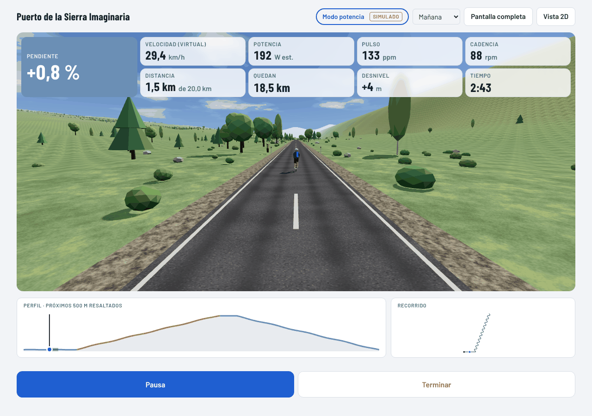

# Rodillo Virtual

Aplicación web para entrenar en rodillo, de uso personal: sesiones estructuradas por zonas de pulso o por potencia, métricas en directo, rutas con pendiente en un mundo 3D, grabación e historial.

Todo corre en el navegador y **los datos se quedan en tu ordenador**. No hay servidor ni cuentas.

**App:** https://oierbidasoa21-stack.github.io/rodillo-virtual/



## Qué hace

- **Sesiones por zonas de pulso** (Z1…Z6, contadas en 10″) **o por % del FTP**, con biblioteca, editor de bloques y repeticiones, e importar y exportar `.zwo`.
- **Player para leer a un metro**: zona con su color, reloj grande, avisos de voz y pitidos, contador de pulso de 10″ y pantalla completa.
- **Sensores Bluetooth**: banda de pulso y sensor de velocidad y cadencia. Sensores simulados para probar sin hardware.
- **Potencia estimada** en rodillo «tonto» con la curva de tu rodillo, ramp test para el FTP, NP, IF y TSS.
- **Rutas** inventadas o tus GPX, con velocidad virtual según la pendiente, vista 3D, fantasma y demo sin sensores.
- **Resumen, historial y forma**: tiempo en zona, carga, kcal, condición y fatiga, gráficas segundo a segundo y exportar TCX.
- **Plan del entrenador** para trabajar con un agente de IA, **copia de seguridad** y **app instalable** que funciona sin conexión.

Cómo se usa todo, paso a paso y con capturas: **[docs/MANUAL.md](docs/MANUAL.md)**.

## Requisitos

- **Chrome** (o Edge) **en el ordenador**. Los sensores usan Web Bluetooth, que solo funciona con HTTPS o en `localhost`.
- Para los sensores, Bluetooth en el ordenador. Sin ellos puedes probarla con los sensores simulados (Ajustes → Desarrollo).

## Arranque rápido

**Web publicada** (lo normal): abre la dirección de arriba en Chrome y, si quieres, instálala desde el icono de la barra de direcciones.

**Docker**, para usarla en tu ordenador:

```sh
docker compose up -d        # después abre http://localhost:8080
```

**Desarrollo** (Node.js 24, ver `.nvmrc`):

```sh
npm install
npm run dev       # servidor local en localhost
npm run test      # tests (Vitest)
npm run lint      # ESLint + Prettier
npm run build     # build de producción en dist/
```

Tus datos personales (peso y zonas) no se suben al repositorio: copia `config/athlete.example.json` a `config/athlete.local.json` (ignorado por git) e impórtalo en **Ajustes → Archivo del atleta**.

## Privacidad

Sesiones, historial, rutas y ajustes se guardan solo en el navegador (IndexedDB). Nada sale de tu ordenador salvo lo que tú exportes: la copia de seguridad, un TCX o el informe para tu entrenador. Cada navegador y cada dirección tiene sus propios datos.

## Documentación

- [`docs/MANUAL.md`](docs/MANUAL.md): manual de uso.
- [`docs/ESTRUCTURA.md`](docs/ESTRUCTURA.md): qué es cada carpeta y archivo del código.
- [`docs/ROADMAP.md`](docs/ROADMAP.md): fases y tareas.
- [`docs/contexto/`](docs/contexto/): estado del proyecto, decisiones y registro de cambios.
- [`docs/agente-entrenador.md`](docs/agente-entrenador.md): cómo usar la app con un agente entrenador.
- [`CLAUDE.md`](CLAUDE.md): arquitectura, stack y convenciones.

Cada push y cada PR pasan lint, tests y build en GitHub Actions (`CI`); los push a `main` publican la app en GitHub Pages (`Deploy`).
