# Manual de uso

Cómo se usa Rodillo Virtual, de principio a fin. Está escrito para alguien que abre la app por primera vez.

Las capturas están hechas con **sensores simulados** y el atleta de ejemplo (`config/athlete.example.json`): los números no son de nadie. Se rehacen con el script [`docs/contexto/pruebas/scripts/t11-capturas-manual.mjs`](contexto/pruebas/scripts/t11-capturas-manual.mjs).

**Índice**

1. [Primeros pasos](#1-primeros-pasos)
2. [Sensores](#2-sensores)
3. [Rodillo y potencia](#3-rodillo-y-potencia)
4. [Biblioteca y editor de sesiones](#4-biblioteca-y-editor-de-sesiones)
5. [El player](#5-el-player)
6. [Rutas y vista 3D](#6-rutas-y-vista-3d)
7. [Al terminar: el resumen](#7-al-terminar-el-resumen)
8. [Historial y forma](#8-historial-y-forma)
9. [Plan del entrenador](#9-plan-del-entrenador)
10. [Datos y copia de seguridad](#10-datos-y-copia-de-seguridad)
11. [Cálculos explicados](#11-cálculos-explicados)
12. [Problemas frecuentes](#12-problemas-frecuentes)

Una regla que se repite en todo el manual: **la app nunca se inventa datos**. Si un sensor no está conectado, lo que depende de él no se muestra. Lo que es una estimación (la potencia en un rodillo «tonto», las kcal) lleva siempre la marca **est.** o «estimada», y lo que viene de sensores simulados, la marca **SIMULADO**.

---

## 1. Primeros pasos

### Abrir la app

Abre https://oierbidasoa21-stack.github.io/rodillo-virtual/ en **Chrome, en el ordenador**. Es la única forma probada: los sensores Bluetooth solo funcionan en Chrome (o Edge) de escritorio.

Arriba están las cinco pestañas: **Sesiones**, **Rutas**, **Historial**, **Sensores** y **Ajustes**. Debajo, la franja de colores con tus seis zonas de pulso, siempre a la vista. Arriba a la derecha, unas «píldoras» dicen qué sensores hay conectados y qué marcan.

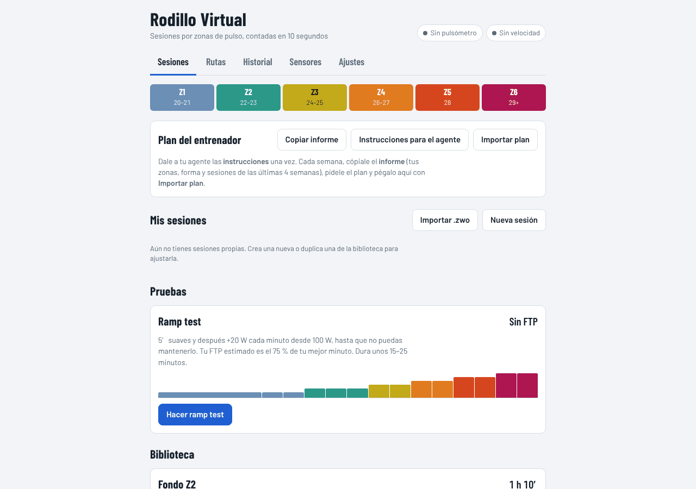

### Instalar como app

La app se puede instalar y después funciona **sin conexión**.

1. Con la app abierta y conexión a internet, pulsa el icono de instalar en la barra de direcciones de Chrome (o menú ⋮ → **Transmitir, guardar y compartir → Instalar página como aplicación**).
2. Se abre en su propia ventana y aparece en el menú Inicio de Windows.
3. Cuando hay una versión nueva sale el aviso **«Nueva versión disponible»** con el botón **Actualizar**. La app nunca se recarga sola, y el aviso no sale mientras haces una sesión o editas una.

### Usarla con Docker (opcional)

Lo normal es la web publicada. Si prefieres tenerla en tu ordenador sin depender de GitHub, con [Docker Desktop](https://www.docker.com/products/docker-desktop/) instalado:

1. Descarga el repositorio y, en su carpeta, ejecuta `docker compose up -d`.
2. Abre **http://localhost:8080** en Chrome. Solo se abre desde ese ordenador. El Bluetooth funciona, porque Chrome trata `localhost` como seguro.
3. Para pararla: `docker compose down`. Para actualizarla: `git pull` y `docker compose up -d --build`.

En un **servidor propio con dominio**, `docker compose --profile prod up -d` la sirve con HTTPS (certificado de Let's Encrypt), que hace falta para el Bluetooth y para instalarla fuera de `localhost`. Los pasos están en [`docs/despliegue/`](despliegue/README.md).

Cada dirección (la web publicada, `localhost:8080` o tu dominio) guarda **sus propios datos**: para pasarlos, usa la copia de seguridad ([apartado 10](#10-datos-y-copia-de-seguridad)).

### Tus datos

En **Ajustes → Tus datos** pon tu **peso**, el **peso de la bici** y la **circunferencia de rueda** (2155 mm para 700×32, 2105 mm para 700×25). El peso sirve para las kcal y la velocidad virtual en las rutas; la rueda, para pasar vueltas de rueda a velocidad.

En el mismo sitio eliges si quieres **avisos por voz**, **pitidos**, el **tema** (claro, oscuro o como el sistema), si se **descarga el archivo al guardar** ([apartado 7](#llevarte-el-archivo)) y la **calidad del 3D** ([apartado 6](#vista-3d)).

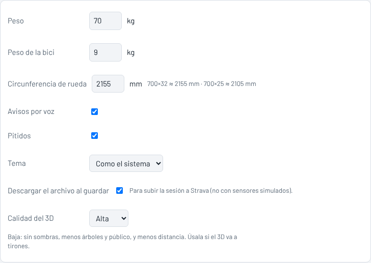

### Zonas de pulso Z1…Z6

La app entrena **por zonas de pulso**, contadas en **10 segundos** (como cuando te tomas el pulso con el dedo). Las ppm salen de multiplicar por 6.

| Zona | Qué es                        | Sensación                            |
| ---- | ----------------------------- | ------------------------------------ |
| Z1   | Muy suave                     | Puedes hablar sin problema           |
| Z2   | Aeróbico, cómodo              | Hablas con frases largas             |
| Z3   | Moderado (tempo)              | Frases cortas                        |
| Z4   | **Umbral**                    | Pocas palabras, duro pero sostenible |
| Z5   | Por encima del umbral         | Hablar cuesta mucho                  |
| Z6   | Máximo (sin límite de arriba) | Sin hablar, esfuerzos cortos         |

En **Ajustes → Zonas de pulso** escribe, para cada zona, desde y hasta qué valor en 10″ llega. Al cambiar el final de una zona se mueve el inicio de la siguiente, para que no queden huecos. **Valores de ejemplo** vuelve a los del archivo de ejemplo.

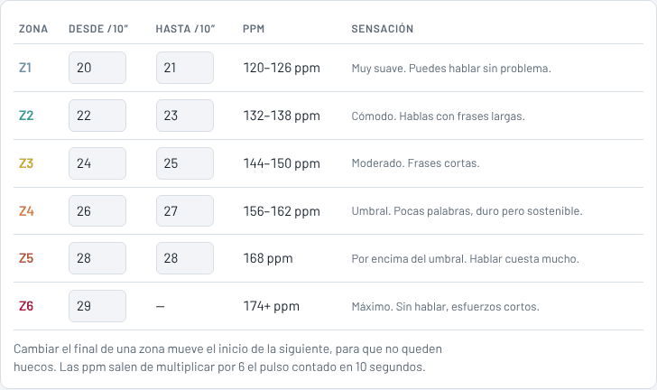

**Archivo del atleta:** si tienes tus datos en un archivo `athlete.json` (peso, bici, rueda y zonas), **Importar athlete.json** los carga de una vez, y **Exportar** los guarda. Si vienes de una versión anterior, la app acepta también los nombres viejos de zona (L1, L2, L3, UA, UA+, VO2).

---

## 2. Sensores

La app lee por Bluetooth:

- una **banda de pulso** (servicio estándar Heart Rate);
- un **sensor de velocidad** en la rueda trasera, con o sin cadencia (servicio estándar CSC).

### Emparejar

1. Pestaña **Sensores → Conectar** en el sensor que quieras.
2. Chrome abre una lista: elige tu sensor. **No lo emparejes antes** en la configuración Bluetooth de Windows.
3. Cuando conecta, la tarjeta pasa a **Conectado** y enseña lo que marca.

Chrome pide elegir el sensor **una vez cada vez que abres la app**. Para evitarlo hay una opción experimental de Chrome:

1. Escribe `chrome://flags/#enable-web-bluetooth-new-permissions-backend` en la barra de direcciones.
2. Pon la opción en **Enabled** y pulsa **Relaunch** para reiniciar Chrome.
3. Conecta tus sensores una vez, como siempre.

Desde entonces la app **recuerda** los sensores y, al abrirla, los conecta sola si están encendidos y cerca (espera hasta 30 segundos a que aparezcan). Si no los encuentra, lo dice y pulsas **Conectar** como antes. Si desconectas un sensor a mano, la app lo olvida. Al ser experimental, puede cambiar con las versiones de Chrome.

### Si se cae un sensor

Si un sensor deja de mandar datos durante una sesión, la app avisa en pantalla y **reintenta conectarlo sola**. Mientras está caído, lo que depende de él desaparece (no se congela el último valor ni se rellena con nada). La grabación sigue con lo demás.

Sin sensor de velocidad no hay rutas ni potencia; sin banda, el tiempo en zona sale de los bloques planificados y no de tu pulso real. Si tu sensor solo mide la rueda, no se muestra cadencia.

### Sensores simulados (sin hardware)

Para probar la app sin nada conectado: **Ajustes → Desarrollo → Sensores simulados**. En la pestaña Sensores aparecen un pulsómetro y un sensor de velocidad de mentira, con un panel para moverlos:

- **Pulso: seguir la zona del bloque**: durante una sesión, el pulso simulado va hacia el centro de la zona de cada bloque;
- deslizadores de pulso, velocidad y cadencia;
- botones para **simular la caída** de cada sensor (unos 5 segundos).

Todo lo simulado va marcado como **SIMULADO**, también en el historial, y no cuenta para la forma.

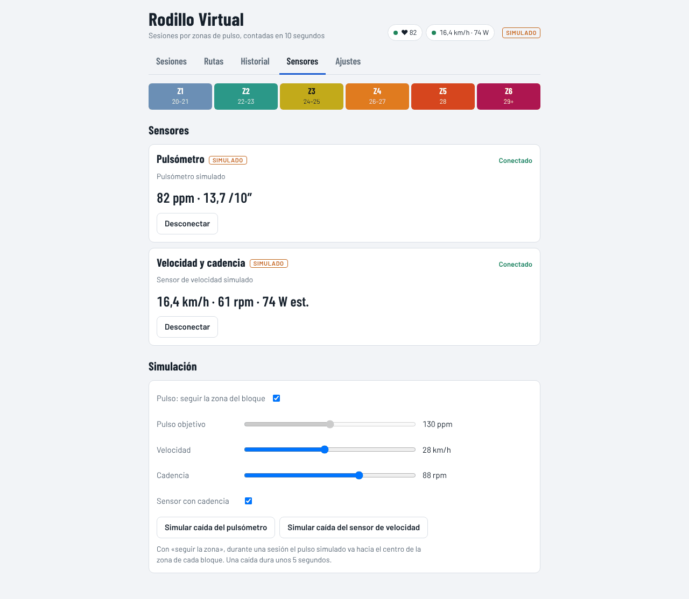

---

## 3. Rodillo y potencia

Un rodillo «tonto» no mide vatios. La app los **estima** con la velocidad de la rueda y la **curva velocidad → potencia** de tu modelo de rodillo. Por eso toda cifra de potencia lleva **est.** o «estimada».

### Elegir el rodillo

**Ajustes → Rodillo y potencia → Rodillo**:

- una de las curvas de la lista (rodillos de fluido con curva publicada, cada una con su fuente);
- **Personalizada**: escribe tu curva como `P = a·v + b·v³` (v en km/h);
- **Ninguno**: la app no muestra potencia.

Los rodillos magnéticos no están en la lista porque su curva cambia con el nivel de resistencia.

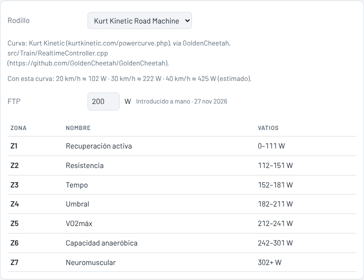

### FTP y ramp test

El **FTP** es la potencia que puedes aguantar más o menos una hora. Hace falta para las sesiones por potencia (vatios objetivo), el IF, el TSS y las zonas de potencia.

- **Escríbelo** en Ajustes → FTP si lo conoces, o
- haz el **ramp test** (Sesiones → Pruebas → **Hacer ramp test**): 5′ suaves y después +20 W cada minuto desde 100 W. La voz dice «Sube a … vatios» en cada escalón. Pulsa **No puedo más** cuando no puedas mantenerlo (un solo toque). Tu FTP estimado es el **75 % de tu mejor minuto**. Pulsa **Guardar como mi FTP**. Si lo hiciste con sensores simulados, la app avisa de que el FTP no es real.

Cambiar el FTP no recalcula las sesiones antiguas: cada una guarda el IF y el TSS con el FTP de ese día.

### Zonas de potencia

Son siete (Z1…Z7, según Coggan) y **no son las mismas que las de pulso**. Salen del FTP y solo aparecen en el resumen y el historial de sesiones con potencia.

---

## 4. Biblioteca y editor de sesiones

La pestaña **Sesiones** tiene, de arriba abajo: el plan del entrenador (ver [apartado 9](#9-plan-del-entrenador)), **Mis sesiones**, **Pruebas** (ramp test) y la **Biblioteca**.

La biblioteca trae 10 sesiones: 8 por pulso (Fondo Z2, Tempo 3×12′ Z3, Umbral 3×10′, Umbral 2×20′, Over-unders, VO2máx 5×3′, 30/30 y Pirámide) y 2 por potencia (Sweet spot 3×12′ y Umbral 2×20′ potencia). Cada tarjeta enseña el perfil con los colores de las zonas y tres botones:

- **Empezar**: abre el player;
- **Duplicar y editar**: hace una copia en «Mis sesiones» para cambiarla;
- **Exportar .zwo**: la guarda en el formato que usan muchas apps de rodillo.

### El editor

**Nueva sesión** (o **Duplicar y editar**) abre el editor. Cada fila es un **bloque**:

- duración en minutos y segundos;
- **objetivo por pulso** (una zona Z1…Z6) **o por potencia** (% del FTP);
- tipo: calentamiento, bloque, recuperación o vuelta a la calma;
- una nota opcional, que se ve en el player.

Con las flechas cambias el orden y con ✕ quitas el bloque. **Añadir repetición** crea un grupo de bloques que se repite las veces que digas (por ejemplo, 5 × [3′ Z5 + 3′ Z1]). Arriba se ve el perfil y la duración total mientras editas. **Guardar sesión** la deja en «Mis sesiones».

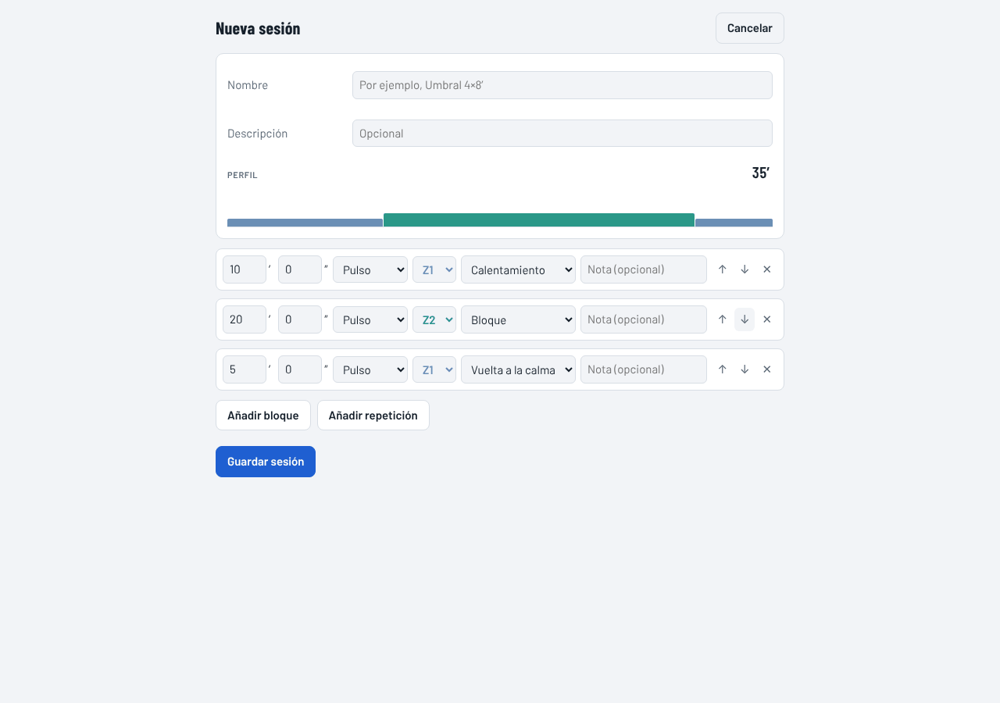

### Importar y exportar `.zwo`

- **Importar .zwo** añade una sesión de otra app a «Mis sesiones». Las rampas se convierten en escalones de 1 minuto.
- Los bloques por pulso no existen en `.zwo`: al exportar se guardan como rodaje libre con la zona en un mensaje. Otras apps no los siguen, pero esta app los recupera al importarlos.

---

## 5. El player

Al pulsar **Empezar** se abre el player. Está pensado para leerse **a un metro**: números grandes y el color de la zona de fondo.

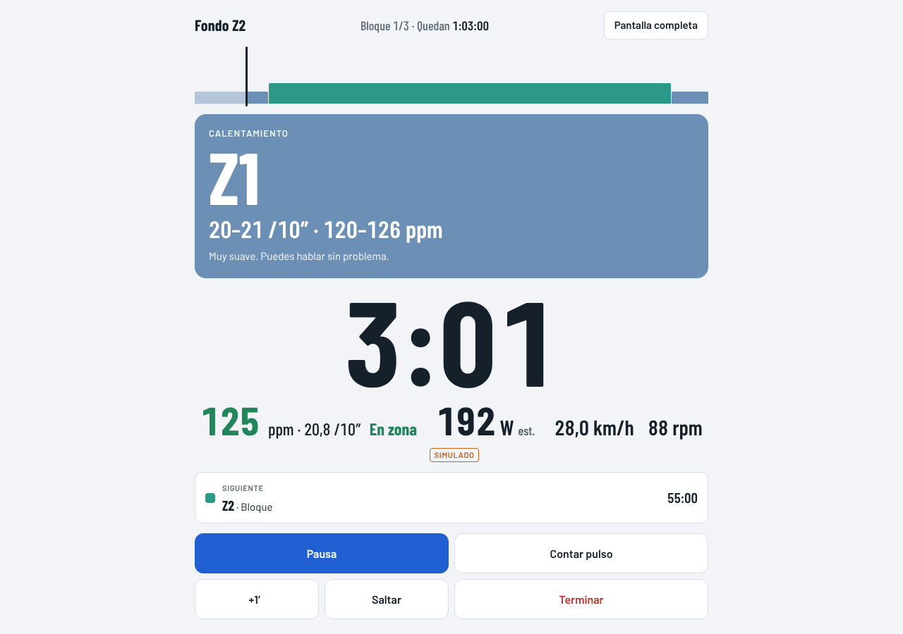

De arriba abajo:

- **nombre de la sesión**, bloque actual y tiempo que queda de sesión;
- el **perfil** de la sesión, con una línea en el punto donde vas;
- la **tarjeta del bloque**, con el color de su zona (al empezar un bloque nuevo entra con una animación corta, para que el cambio se vea desde la bici): tipo de bloque, zona, rango en /10″ y en ppm, y la sensación que debería dar. En bloques por potencia, los vatios objetivo con una banda de ±5 % (o el % si no hay FTP);
- el **reloj** del bloque, que se pone en aviso en los últimos 10 segundos y, en los **últimos 5**, se convierte en un solo dígito grande (5, 4, 3, 2, 1) que late cada segundo;
- las **métricas en directo**: pulso en ppm y /10″ con **En zona / Por encima / Por debajo**, potencia estimada, velocidad y cadencia (solo lo que tenga sensor);
- **Siguiente**: el próximo bloque y su duración.

### Botones

| Botón                 | Qué hace                                                                         |
| --------------------- | -------------------------------------------------------------------------------- |
| **Empezar / Pausa**   | Arranca o para el reloj                                                          |
| **Contar pulso**      | Contador guiado de 10″ (solo en bloques por pulso)                               |
| **+1′**               | Alarga el bloque actual un minuto                                                |
| **Saltar**            | Pasa al siguiente bloque                                                         |
| **Terminar**          | Acaba la sesión; hay que pulsarlo dos veces para no hacerlo sin querer           |
| **Pantalla completa** | Toda la pantalla para la sesión. También con la tecla **F**; se sale con F o Esc |

Mientras corre una sesión, la pantalla del ordenador no se apaga sola.

### Contador de pulso de 10″

Para quien entrena sin banda. **Contar pulso → Empezar**: cuenta atrás 3-2-1, un pitido para empezar a contar, 10 segundos, doble pitido para parar, y después un teclado para meter el número. El resumen enseña cada conteo y si estaba en zona. Los pitidos del contador suenan siempre, aunque estén apagados en Ajustes, porque el conteo depende de ellos.

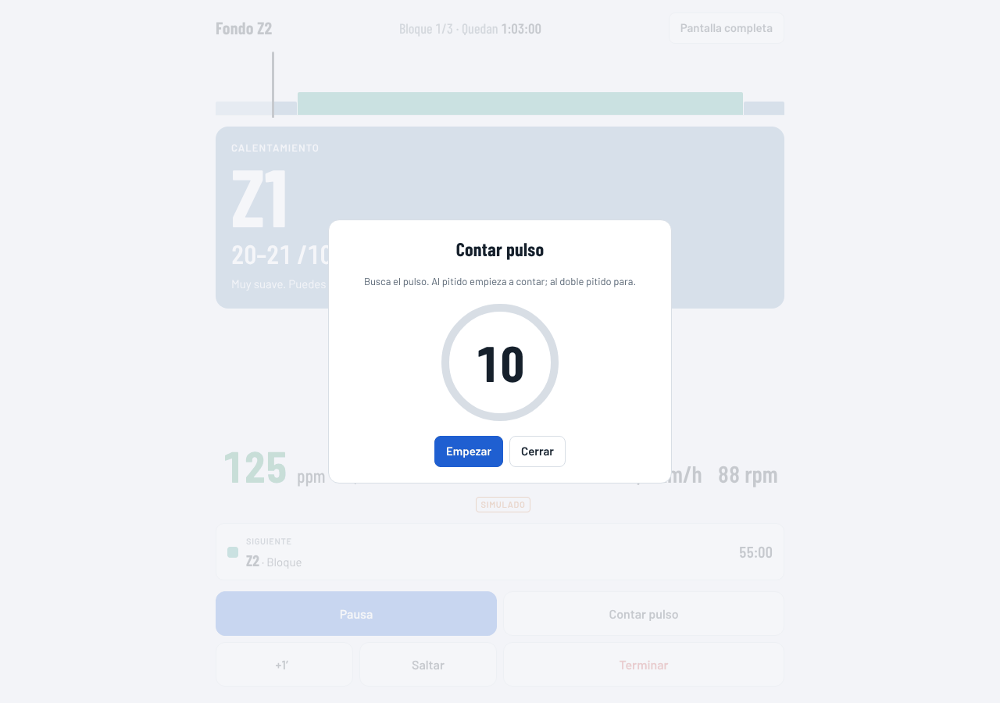

### Avisos de voz y pitidos

Con **Avisos por voz** y **Pitidos** activados en Ajustes:

- **al empezar la sesión** (y al saltar de bloque), la voz dice el tipo de bloque, la zona y la duración (por ejemplo, «Calentamiento, zona uno, 10 minutos»);
- **10 segundos antes** de acabar un bloque avisa del siguiente («En diez segundos: recuperación, zona uno»), con pitidos de cuenta atrás y otro al cambiar;
- en bloques de 4 minutos o más dice **«Mitad del bloque»**, y en los de 5 minutos o más, **«Último minuto»**;
- **pulso fuera de zona** (con banda conectada): después del primer minuto del bloque, si el pulso lleva 25 segundos seguidos fuera de la zona, avisa «Pulso por encima de la zona, afloja un poco» o «Pulso por debajo de la zona, aprieta un poco». No repite antes de 90 segundos. Cuando vuelves y aguantas 10 segundos dentro, dice «Pulso en zona, así». En recuperaciones y vuelta a la calma no avisa por ir por debajo, solo por ir alto;
- **en rutas**, avisa de las subidas: 300 m antes («Subida en 300 metros: 1,2 kilómetros al 6 por ciento»), a 500 m de la cima en las subidas largas, y en la cima;
- **al terminar**, un resumen hablado: minutos, carga y pulso medio.

### Sesión sin terminar

La sesión en curso se guarda cada 10 segundos, al pausar y al cambiar de pestaña. Si se cierra la app a medias, al volver aparece **«Sesión sin terminar»** con tres opciones: **Retomar** (sigue en pausa donde estaba), **Guardar** (la guarda con lo hecho) y **Descartar**.

---

## 6. Rutas y vista 3D

En la pestaña **Rutas** hay tres rutas de ejemplo **inventadas** (un llano de 20 km, un puerto de 8 km al 6 % y un rompepiernas) y tus rutas importadas.

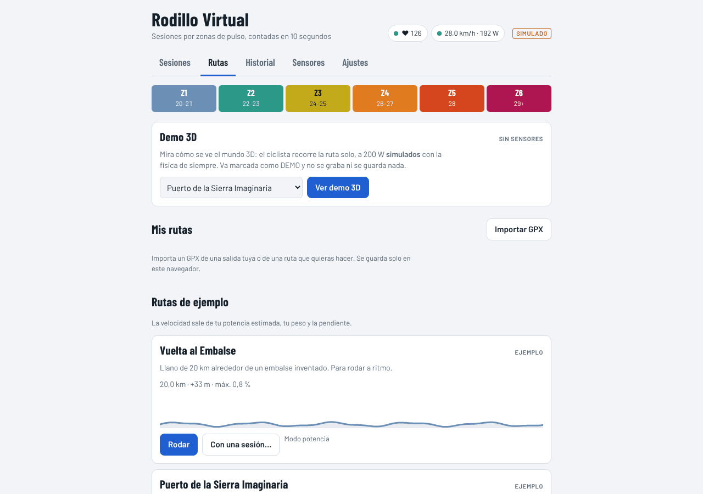

### Importar un GPX

**Importar GPX** carga una ruta con altitud (de una salida tuya o de una ruta hecha en gpx.studio, Strava, Komoot o RideWithGPS). Se guarda **solo en este navegador**. La app la remuestrea cada 10 m y suaviza la altitud, para que el ruido del GPS no dé pendientes falsas.

### Rodar o hacer una sesión sobre la ruta

- **Rodar**: salida libre por la ruta.
- **Con una sesión…**: eliges una sesión de la biblioteca o tuya y la haces sobre la ruta. La ruta da vueltas hasta que acaba la sesión, y el resumen dice cuántas.

Las rutas necesitan el **sensor de velocidad**.

### Modo potencia y modo rueda

Siempre se ve con qué modo estás rodando, arriba a la derecha:

- **Modo potencia** (hay un rodillo elegido en Ajustes): la velocidad es **virtual**. Sale de tu potencia estimada, tu peso más el de la bici y la pendiente. En las subidas vas más despacio y en las bajadas ruedas aunque no pedalees.
- **Modo velocidad de rueda · sin potencia** (sin rodillo): avanzas a la velocidad real de tu rueda y la pendiente solo se muestra.

### Vista 3D

Al rodar, la ruta se ve en 3D si el navegador tiene WebGL (Chrome lo tiene):

- la carretera sale de la altimetría y sigue las curvas de forma suave;
- hay paisaje (bosque, montañas, cielo con nubes), público que anima, quitamiedos y un ciclista que se inclina en las curvas, seguido por la cámara;
- encima va el **HUD** con pendiente, velocidad, potencia, pulso, cadencia, distancia, lo que queda, desnivel y tiempo;
- debajo, el **perfil** con los próximos 500 m resaltados y el **recorrido** (minimapa sin mapa de fondo, funciona sin conexión).

El selector de **hora del día** cambia entre mañana, mediodía y atardecer. **Vista 2D** vuelve a la vista plana. **Pantalla completa** (o **F**) funciona igual que en el player. La parte 3D se descarga la primera vez y después funciona sin conexión.

**Calidad del 3D** (Ajustes → Tus datos): **Alta** (la de siempre), **Media** o **Baja**. En baja no hay sombras, se dibujan algo más de un tercio de los árboles, matorrales y rocas y menos de un tercio del público, y el horizonte queda más cerca. Úsala si el 3D va a tirones en tu portátil; la carretera, el ciclista y los datos son los mismos.

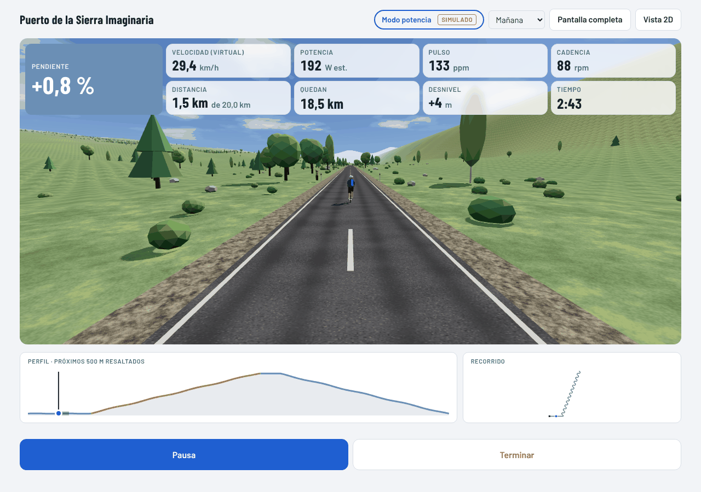

### Fantasma

Al repetir una ruta, rueda contigo tu **salida más rápida en ella** (sale de su grabación), y se ve cuántos segundos le sacas o te saca.

- En 3D es un ciclista **azul claro y semitransparente**, con una etiqueta encima (por ejemplo, «Tú · 23 nov», el día de esa salida) que se lee igual de cerca que de lejos.
- En el **perfil de la ruta** sale como una raya discontinua, y una barra une su posición con la tuya: verde si vas por delante, roja si vas por detrás.

### Demo 3D

**Rutas → Demo 3D**: elige una ruta y pulsa **Ver demo 3D** para ver el mundo sin ningún sensor. El ciclista avanza solo a 200 W **simulados**. Va marcada como DEMO y no se graba nada.

El paisaje con mapas reales todavía no existe: está planificado en las fases 10–12 del [`ROADMAP`](ROADMAP.md).

---

## 7. Al terminar: el resumen

Al pulsar **Terminar** (dos veces) sale el resumen. Si la sesión ha durado **menos de 1 minuto**, no se guarda en el historial.

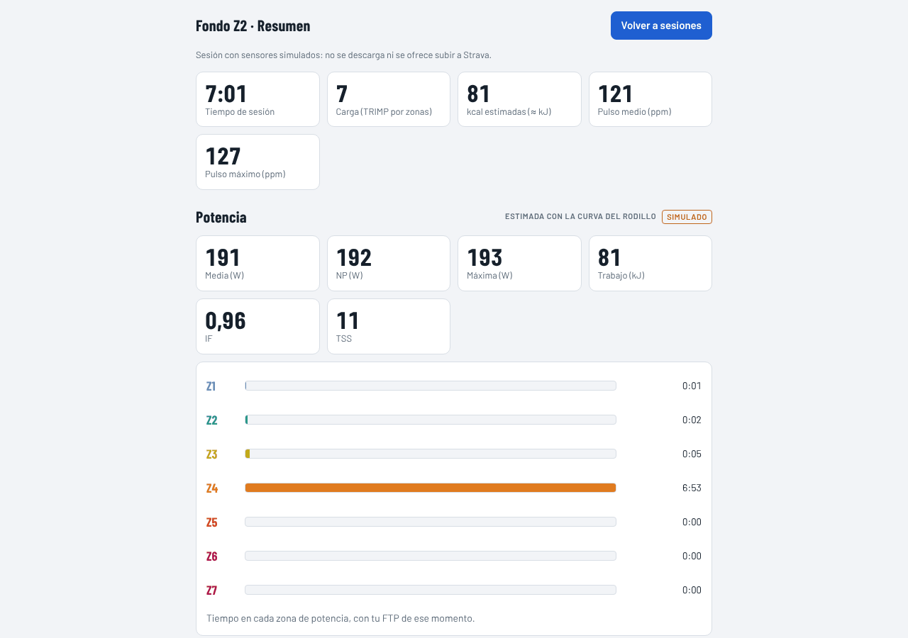

Lo que puede salir, según los sensores que había:

- **siempre**: tiempo de sesión, **carga** y **kcal estimadas**;
- **con banda de pulso**: pulso medio y máximo, y el **tiempo en cada zona de pulso** medido, con un **anillo** que muestra qué parte del total fue en cada zona (y el porcentaje al lado). Sin banda, el tiempo en zona sale de los bloques que has hecho;
- **con conteos de 10″**: la tabla de cada conteo y cuántos estaban en zona;
- **con potencia estimada**: media, **NP**, máxima, trabajo (kJ), y con FTP también **IF**, **TSS** y el tiempo en cada zona de potencia. Las kcal pasan a salir de los kJ;
- **en una ruta**: distancia, velocidad media, desnivel y vueltas.

Los cálculos se explican en el [apartado 11](#11-cálculos-explicados).

### Llevarte el archivo

**Al guardar una sesión**, la app descarga sola su archivo (TCX) y el resumen muestra una tarjeta para **subirla a Strava**:

1. Pulsa **Abrir Strava para subir**: se abre en otra pestaña la página de subida de Strava (con tu sesión de Strava iniciada).
2. Elige el archivo recién descargado (está en tu carpeta de Descargas, con un nombre como `rodillo-2026-11-28-1830-fondo-z2.tcx`) y confirma en Strava.

Son unos 20 segundos y no hace falta conectar la app con Strava: no se guarda ninguna contraseña ni clave. Si cierras la tarjeta, en el detalle de la sesión del **Historial** tienes **Exportar TCX** y **Abrir Strava para subir**. El mismo archivo sirve para Garmin Connect o intervals.icu.

- **Ajustes → Descargar el archivo al guardar** (activado de serie) lo desactiva si prefieres descargarlo solo cuando quieras.
- Las sesiones con **sensores simulados** no se descargan ni se ofrecen a Strava: no son datos tuyos.
- El archivo marca la potencia como **estimada** en sus notas. En las rutas de ejemplo, que son inventadas, va **sin posición GPS**; en tus GPX importados, con ella.

La exportación FIT para el entrenador está planificada en la Fase 15b del [`ROADMAP`](ROADMAP.md).

---

## 8. Historial y forma

La pestaña **Historial** tiene, arriba, las sesiones, el tiempo y la carga de los últimos 7 días, el panel **Forma** y, debajo, la lista de sesiones (fecha, nombre, duración, carga, kcal y TSS).

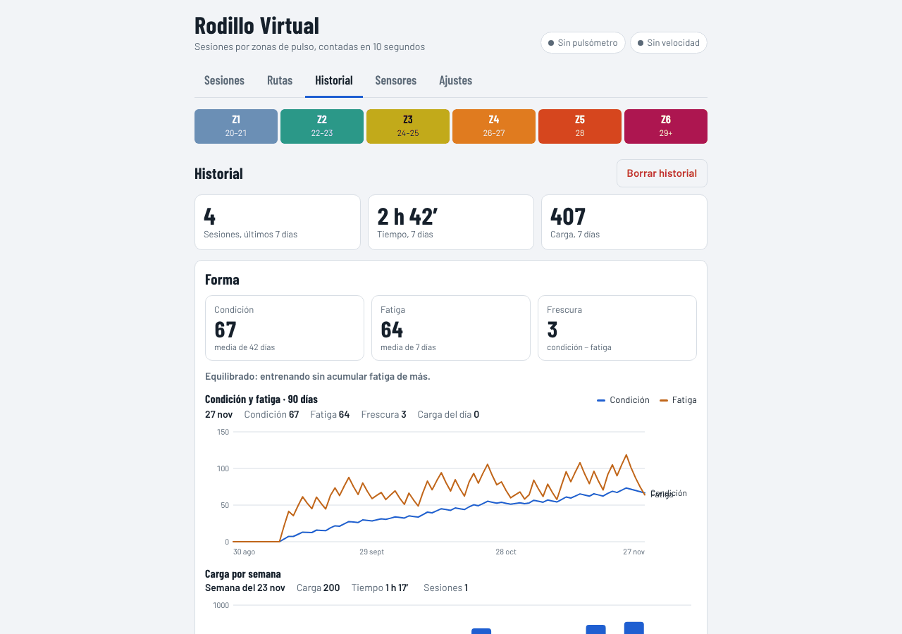

### Forma

- **Condición**: la media de la carga de los últimos 42 días. Sube despacio cuando entrenas con constancia.
- **Fatiga**: la media de los últimos 7 días. Sube y baja rápido.
- **Frescura**: condición menos fatiga. Muy negativa = mucha fatiga acumulada; positiva = descansado.

Debajo están la curva de condición y fatiga de 90 días (pasa el ratón para ver cada día) y la carga por semana. Las sesiones con sensores simulados no cuentan.

### Detalle de una sesión

Pulsa una fila para abrir su detalle: el mismo resumen del final, **Exportar TCX**, **Abrir Strava para subir**, **Borrar sesión** y una **gráfica por cada dato grabado** (pulso sobre los colores de tus zonas, potencia, velocidad, cadencia y, en ruta, altitud). Pasa el ratón por encima para ver los valores de cada segundo. Las sesiones de antes de la grabación solo tienen resumen.

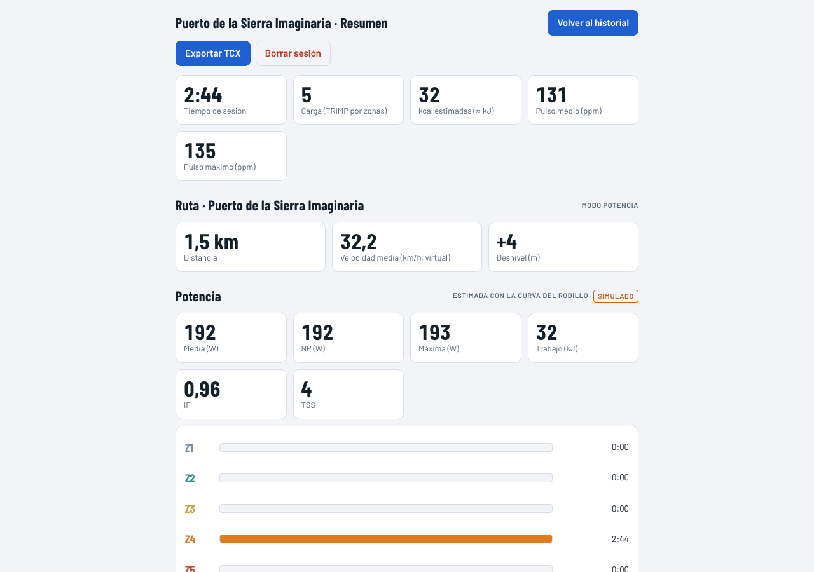

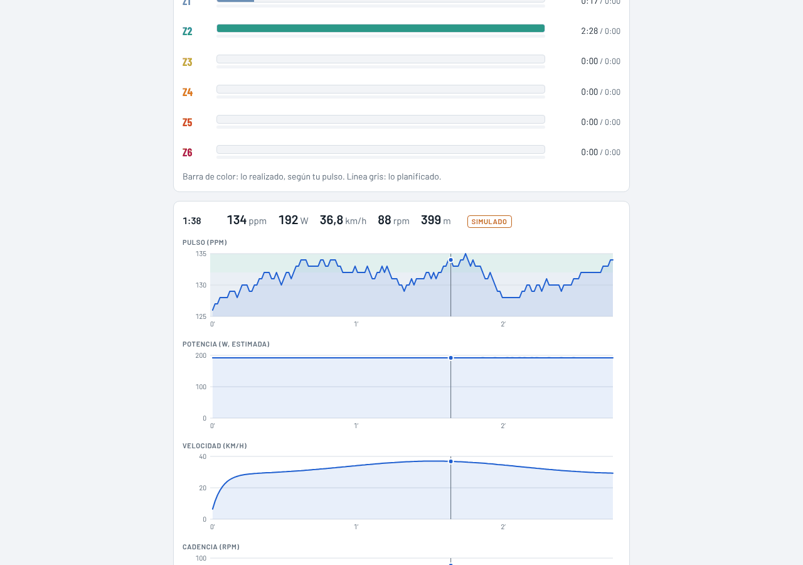

**Borrar historial** (arriba a la derecha) lo borra todo; pide confirmación.

---

## 9. Plan del entrenador

Si usas un agente de IA como entrenador, la app se entiende con él copiando y pegando (no hay servidor). Está en **Sesiones → Plan del entrenador**:

1. **Una vez:** **Instrucciones para el agente** descarga un archivo con el formato del plan. Dáselo a tu agente.
2. **Cada semana:** **Copiar informe** copia tus zonas, tu forma y las sesiones de las últimas 4 semanas. Pégaselo al agente y pídele el plan.
3. **Importar plan:** pega su respuesta tal cual. Si algo no encaja, la app dice qué y no importa nada.
4. El plan aparece en Sesiones día a día. **Empezar** abre la sesión del día y, al guardarla, queda como **✓ Hecha**.

El detalle está en [`docs/agente-entrenador.md`](agente-entrenador.md). El informe lleva tus datos: solo sale de la app cuando tú lo copias.

---

## 10. Datos y copia de seguridad

**Todo se guarda en el navegador** de ese ordenador (IndexedDB): sesiones, historial con grabaciones, rutas importadas y ajustes. No hay servidor ni cuentas. Cada navegador y cada dirección (la web publicada, `localhost:5173`, `localhost:8080`) tiene **su propia base**: lo que guardas en una no aparece en otra.

La app pide al navegador **almacenamiento persistente** para que no borre tus datos si le falta espacio. En **Ajustes → Datos en este dispositivo** ves si lo ha concedido; con la app instalada suele concederlo.

### Exportar e importar la copia

- **Exportar copia** guarda todo en un archivo JSON.
- **Importar copia** enseña qué contiene el archivo y, si confirmas, **reemplaza** todo lo guardado en ese navegador.

Sirve para pasar tus datos a otro ordenador o recuperarlos. La copia lleva datos personales (peso, zonas y entrenamientos): guárdala en un sitio tuyo, nunca en el repositorio.

### Qué se pierde si borras los datos de Chrome

Si borras los datos del sitio («Borrar datos de navegación» con «Cookies y otros datos de sitios», o desinstalas la app y marcas borrar datos), **se pierde todo**: sesiones propias, historial, rutas y ajustes. Haz una copia antes.

---

## 11. Cálculos explicados

### Carga por pulso

Minutos en cada zona multiplicados por un peso: Z1 × 1, Z2 × 2, Z3 × 3, Z4 × 4, Z5 × 5, Z6 × 6. Por ejemplo, 30′ en Z2 y 20′ en Z4 dan 30 × 2 + 20 × 4 = **140**. Sirve para comparar sesiones entre sí (al estilo del TRIMP), no es una unidad física.

### kcal

- **Sin potencia**: MET de cada zona × peso × horas. Los MET van de 5 (Z1) a 14 (Z6). Es una estimación con un margen de **±20 %**.
- **Con potencia**: kcal ≈ kJ de trabajo. Funciona porque el cuerpo aprovecha más o menos un 24 % de la energía, y 1 kcal son 4,18 kJ: las dos cosas casi se anulan.

### NP, IF y TSS (solo con potencia)

- **NP** (potencia normalizada): la potencia «equivalente» de una sesión con cambios de ritmo. Se hace la media de cada 30 segundos, se eleva a la cuarta, se promedia y se saca la raíz cuarta. Pesa más los tramos duros, que cansan más de lo que dice la media.
- **IF** (factor de intensidad) = NP ÷ FTP. 1,0 es ir a tu FTP.
- **TSS** = horas × IF² × 100. Una hora justo a tu FTP vale 100.

### Velocidad virtual en las rutas

En modo potencia, la app busca la velocidad a la que tu potencia estimada iguala lo que cuesta avanzar:

- el **aire** (crece con la velocidad al cubo),
- la **rodadura** de las ruedas,
- la **pendiente** (subir tu peso más el de la bici).

Usa valores típicos de un ciclista en carretera (CdA 0,32, Crr 0,005, 97,5 % de eficiencia de la transmisión). Por eso, con los mismos vatios, vas a unos 30 km/h en llano y bastante menos en una subida del 6 %.

---

## 12. Problemas frecuentes

**El sensor no aparece en la lista de Chrome.**

- Usa Chrome (o Edge) en el ordenador; otros navegadores no tienen Web Bluetooth.
- La banda necesita contacto con la piel (moja los electrodos).
- El sensor no puede estar conectado a otro dispositivo a la vez (reloj, móvil u otra app). Ciérralos.
- No lo emparejes en la configuración Bluetooth de Windows: se elige solo desde la app.
- Comprueba que el Bluetooth del ordenador está encendido.

**El sensor se desconecta durante la sesión.** La app avisa y reintenta sola. Si pasa a menudo: acerca el ordenador a la bici, cambia la pila del sensor y aleja otros aparatos inalámbricos.

**Tengo que elegir el sensor cada vez que abro la app.** Es lo normal en Chrome. Con la opción experimental del [apartado 2](#emparejar) la app los recuerda y los conecta sola.

**No sale la potencia.** Elige tu rodillo en Ajustes → Rodillo y potencia y conecta el sensor de velocidad. Sin las dos cosas, la app no la muestra.

**Las sesiones por potencia enseñan % y no vatios.** Falta el FTP: escríbelo en Ajustes o haz el ramp test.

**La app no se actualiza.** Espera el aviso «Nueva versión disponible» y pulsa **Actualizar** (no sale durante una sesión). Si no aparece, cierra todas las ventanas de la app y vuelve a abrirla con conexión.

**La vista 3D no se ve o va a tirones.** Necesita WebGL: en Chrome, Configuración → Sistema → «Usar aceleración por hardware cuando esté disponible» activado. Si se ve pero va lenta, baja la **Calidad del 3D** en Ajustes a Media o Baja. **Vista 2D** siempre funciona.

**No veo mis datos.** ¿Estás en la misma dirección de siempre? La web publicada, `localhost:5173` (`npm run dev`) y `localhost:8080` (Docker) guardan cada una sus propios datos. Pásalos con Exportar copia e Importar copia.

**`localhost` o la web publicada.** Las dos valen para Bluetooth (Chrome trata `localhost` como seguro). La web publicada es la referencia y se actualiza sola; `localhost` es para desarrollar o para usar la app con Docker en tu ordenador. Desde otro equipo de la red, sin HTTPS, el Bluetooth no funciona.
